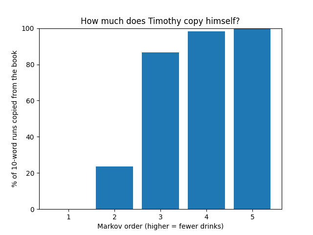
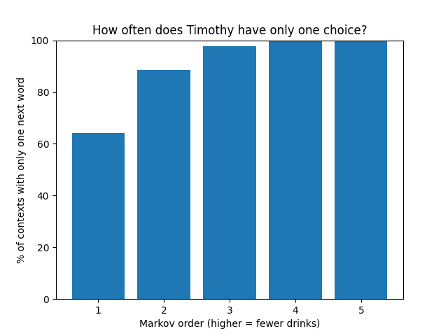

# Another Pickle for the Knowing Ones

Timothy Dexter was an 18th-century merchant from Massachusetts who wrote a book called A Pickle for the Knowing Ones (1802). He spelled words however he liked and used no punctuation at all. I built a Markov chain that learns from his book and writes new text in his style, then tested how much of what it writes is actually new.

## Goal
The book is only about 8,400 words long. I wanted to see how much context the Markov chain can use (its order) before it stops making new sentences and just starts copying the book.

## Findings



| Order | Drinks | Copied from the book (estimate) | Contexts with only one next word |
|-------|--------|---------------------------------|----------------------------------|
| 1     | 5+     | about 0%                        | 64%                              |
| 2     | 4      | about 24%                       | 89%                              |
| 3     | 3      | about 87%                       | 98%                              |
| 4     | 2      | about 98%                       | 99.6%                            |
| 5     | 1      | about 99.7%                     | 99.9%                            |

Only order 1 really writes something new. Order 2 is a mix, and from order 3 up it is basically
reciting the book. The last column shows why: the book is so short that at order 3, 98% of the word
sequences the chain knows are followed by only one possible next word, so it has no choice except to
repeat Dexter. That column comes straight from the book, so unlike the copying estimate it's the same
every run.



## Testing

For each order, I had the generator write 10 new "books", each as long as the original. Then I checked
how many runs of 10 words in a row in each one appear word for word in the real book, and averaged the
results.

The numbers are estimates, since the books are random. They change by a few tenths of a percent each
time I run it, but the pattern stays the same.

I used runs of 10 because a chain of order *n* always copies at least *n* + 1 words in a row by design,
so the test has to be longer than that (at least 7 for order 5) to mean anything. I also tried 7, 8 and
9: the numbers drop as the run gets longer, but the pattern is the same every time.

## Generator

Run it and it asks how many drinks Timothy has had. The more he drinks, the lower the order and the
more jumbled he gets:

- 5 or more drinks → order 1
- 4 → order 2, 3 → order 3, 2 → order 4
- 1 drink → order 5, which is almost straight from the book
- 0 drinks → a sober Timothy has nothing new to say, and tells you (in his spelling) to go read the real book

**5 drinks:**
> marchents are toue hash my father Addoms is the helm in grosing three all is troue fourder frinds of A
> Companon soun good pen and

**1 drink:**
> the gost yearst Last march thay where maried I was maried to the gost thirtey five Last may I have bin
> in hell all the time

Before training, I cut the book down to Dexter's own writing (no editor's preface or appendix) and
removed page numbers and headings. I kept his spelling exactly as he wrote it.

## Running

You need Python 3 and matplotlib.

```bash
pip install -r requirements.txt
python dexter_markov.py      # the generator
python dexter_analysis.py    # the test: prints the table and saves the two charts
```

## Files

- `generator.py`: the generator
- `analysis.py`: the test, which uses the generator's code
- `data/pg43453.txt`: the book, from [Project Gutenberg](https://www.gutenberg.org/ebooks/43453)
- `outputs/copying_by_order.png`: chart of how much each order copies the book
- `outputs/one_choice_by_order.png`: chart of how often each order has only one possible next word

## Limitations

- The book is tiny, so even at order 1 a lot of words only have one or two possible next words.
- The output doesn't mean anything. It's new word order in his style, not new ideas.
- Gutenberg has the 1848 edition, which might be slightly different from the 1802 original.
- The exact numbers depend on the run length I picked, especially for order 2.
